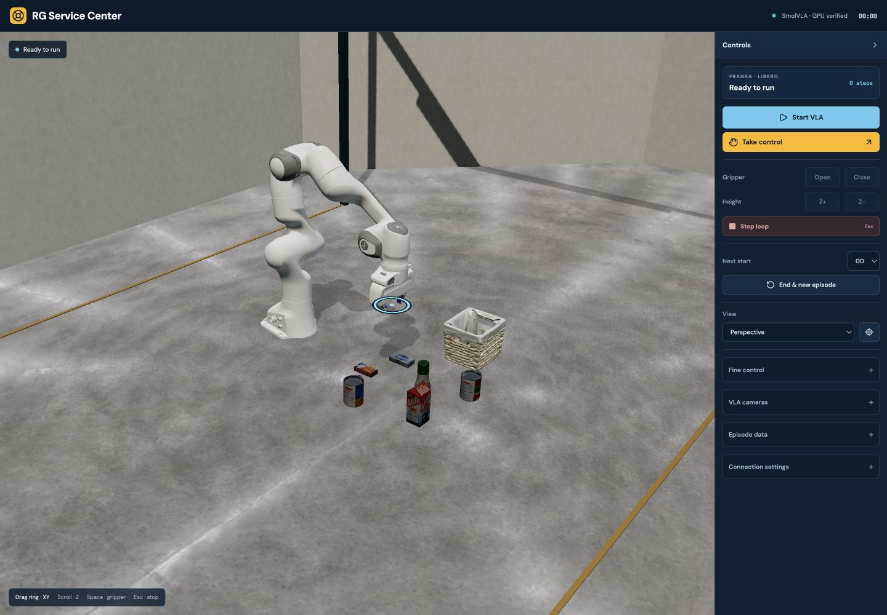
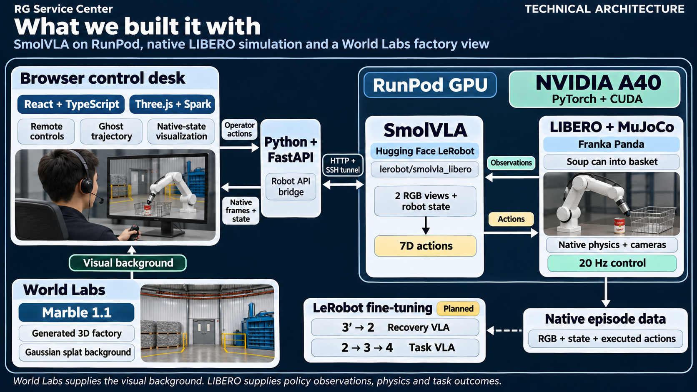

<div align="center">

# RG Service Center

### When robots fail, get them back to work.

A remote recovery desk for robot operators — with intervention data for better policies.

**[Quick start](#quick-start) · [Demo walkthrough](#demo-walkthrough) · [Architecture](#architecture) · [Technical docs](#technical-docs)**



</div>

## The problem

A failed robot task becomes an operations problem: someone has to inspect what happened, recover the robot, and get the task moving again. The intervention also contains useful knowledge that is easy to lose.

**RG Service Center brings remote recovery and intervention recording into one workflow.** Operators can inspect recent motion, take control, complete a recovery, and preserve the demonstration for future policy learning.

## What we built

- **Real VLA inference.** A pinned SmolVLA checkpoint runs on a remote GPU against native LIBERO simulation.
- **A browser recovery desk.** Inspect the workcell, view native cameras, and take over end-effector and gripper control.
- **Ghost history.** Review earlier robot configurations and the end-effector path during recovery.
- **Native intervention recording.** Capture two RGB cameras, robot state, executed actions, controller ownership, and phase boundaries.
- **Two learning paths.** Export recovery and task-continuation segments separately, with conversion tooling for LeRobot datasets.

The current task uses a **Franka Panda** to **pick up an alphabet soup can and place it in a basket**. The browser's factory background is visual context; native LIBERO owns task physics, policy observations, and success detection.

## Quick start

**Preview the interface without a GPU:**

```sh
git clone https://github.com/Sehyeogkim/YC_compiled_Hackathon.git
cd YC_compiled_Hackathon/control-ui
npm ci
npm run dev
```

Requires **Node.js 20.19+ or 22.12+** and a WebGL2-capable browser. Open the URL printed by Vite, expand **Connection settings**, and select **Offline demo**. This is a separate scripted simulation for exploring the interface.

**Run actual VLA inference:** follow the [GPU setup guide](docs/SETUP.md). The live path uses a Linux CUDA GPU host, the pinned SmolVLA/LIBERO runtime, and an SSH tunnel. The recorded integration smoke ran on an **NVIDIA A40**. Included factory assets require no API credentials to view.

## Demo walkthrough

1. **Observe:** connect the GPU and select **Start VLA** to run the pretrained policy.
2. **Take over:** when you observe a failure, select **Take control**. Queued policy actions are cleared.
3. **Recover:** inspect Ghost history and use mouse or keyboard controls to move to a resumable state.
4. **Mark the boundary:** select **Recovery complete → task**, keeping the human in control.
5. **Finish and record:** complete the task, then end the episode. Native LIBERO supplies the task-success predicate.

One intervention can yield two distinct segments:

| Segment | Demonstration | Learning objective |
| --- | --- | --- |
| **Recovery · R′** | Failed state → resumable state | Train a recovery policy |
| **Task continuation · R** | Resumable state → completed task | Improve the task policy |

Both proposed fine-tuning branches start independently from the same pretrained policy **P**. Original episode lineage is retained across exports.

## Architecture



The browser sends operator commands to the FastAPI bridge. SmolVLA and human controls share one native LIBERO simulator; its observations and executed actions feed the intervention records. Qualified recovery and task segments form separate datasets for the planned training branches. World Labs supplies the browser background only.

| Layer | Stack |
| --- | --- |
| Operator interface | React · TypeScript · Vite |
| 3D visualization | Three.js · MuJoCo WASM · Spark |
| Factory background | World Labs Marble 1.1 Gaussian splat |
| Robot API | Python · FastAPI |
| Policy inference | SmolVLA · Hugging Face LeRobot · PyTorch · CUDA |
| Native simulation | LIBERO · MuJoCo · Franka Panda |

## Prototype status

**Implemented:** pretrained inference, native simulation, human takeover, Ghost history, intervention recording, segment export, and dataset-conversion tooling.

**Recorded verification:** [20 actual policy-driven native steps on an NVIDIA A40](inference/proof/native-policy-smoke.json). This is integration evidence; it does not establish a task-success rate or learned recovery improvement.

**Next:** qualify human demonstrations, fine-tune separate task and recovery policies, and compare them on held-out native starts. Automatic failure diagnosis, learned recovery, technician dispatch, and real-robot deployment are future work. Failure recognition and the recovery boundary currently rely on the operator.

## Technical docs

| Guide | Contents |
| --- | --- |
| [Setup and prerequisites](docs/SETUP.md) | Local UI, pinned GPU runtime, SSH tunnel |
| [Control desk](control-ui/README.md) | Interface modes, controls, recording semantics |
| [Inference service](inference/README.md) | Model pins, runtime configuration, smoke checks |
| [API protocol](inference/PROTOCOL.md) | Commands, state, cameras, control ownership |
| [Collection and export](inference/COLLECTION_HANDOFF.md) | Native records and segment qualification |
| [Learning and evaluation](training/README.md) | R / R′ experiments and held-out comparisons |
| [Third-party notices](control-ui/THIRD_PARTY_NOTICES.md) | Asset sources and upstream licenses |

## Repository map

```text
control-ui/       Browser desk, native-state visualization, offline demo
inference/        GPU API, native simulation, recording, segment export
training/         Dataset conversion, fine-tuning, evaluation utilities
docs/             Setup guide and presentation assets
```

Internal runtime identifiers retain the earlier `werescue` name for compatibility. The product is **RG Service Center**.
